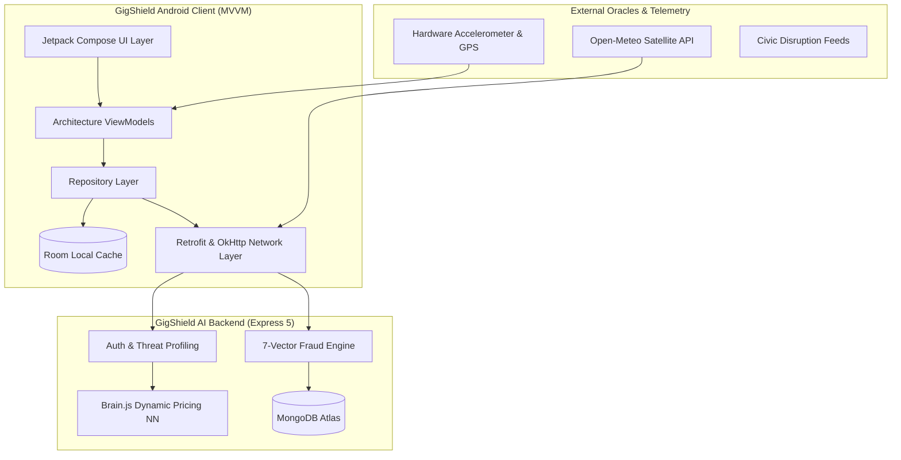

# GigShield Mobile — Architectural Specification

---

## 1. System Philosophy & Design Principles

**GigShield Mobile** is a native Android application built on the principle of **Parametric Zero-Touch Micro-Insurance**. Unlike traditional indemnity insurance that requires manual claim filing, paperwork, and lengthy adjuster investigations, GigShield automatically validates external objective parameters (rainfall, air quality, curfew orders, platform server status) and settles claims within seconds directly into the gig worker's digital wallet via Razorpay UPI.

---

## 2. Layered Clean Architecture

The application strictly separates responsibilities into distinct architectural layers:

### A. Presentation Layer (`com.gigshield.mobile.ui`)
* **Framework:** Jetpack Compose + Material 3.
* **Pattern:** Model-View-ViewModel (MVVM) with Unidirectional Data Flow (UDF).
* **State Management:** Reactive `StateFlow` collected safely via `collectAsState()` in Compose lifecycle.
* **Component Styling:** Custom fintech dark theme featuring Emerald (`#10B981`), Teal (`#14B8A6`), Cyan (`#06B6D4`), and Deep Slate surfaces (`#0B0F19`, `#0F172A`, `#1E293B`).
* **Interactive Modals:** Native Compose implementation of the **Razorpay UPI Simulator**, with authentic animated transition from NPCI connection spinner to green checkmark credit confirmation.

### B. Domain Layer (`com.gigshield.mobile.domain.model`)
* Pure Kotlin data structures free from Android SDK and framework dependencies:
  * `User`: Identity, threat profile, policy coverage limits, and balance.
  * `Claim`: Adjudicated claims with 7-vector fraud inspection breakdown.
  * `InsurancePlan`: Tiers (**Basic**, **Pro**, **Elite**) with dynamic pricing multipliers.
  * `EarningsSummary`: Shift-by-shift income loss vs. recovered payout analytics.
  * `DisruptionTrigger`: Supported external disruption event definitions.

### C. Data & Repository Layer (`com.gigshield.mobile.data`)
* **Repositories:** Single source of truth for the ViewModels:
  * `AuthRepository`: User authentication, profile updates, and JWT session handling.
  * `InsuranceRepository`: Dynamic AI risk score fetching, policy subscription, and cancellation.
  * `ClaimsRepository`: Zero-touch claim simulation, history retrieval, and caching.
* **DTO Mappers:** Explicit translation between backend JSON responses and domain models.

### D. Core Services (`com.gigshield.mobile.core`)
* **Networking (`core.network`):** Configurable Retrofit 2 + OkHttp 4 client with timeout handling and `AuthInterceptor`. Includes a `MockApiClient` providing instant, offline demo capability.
* **Persistence (`core.database`):** Room database caching user policies and claim history for offline operation during severe storms.
* **Sensors (`core.sensor`):** Real-time hardware `SensorManager` calculating dynamic biomechanical accelerometer variance to satisfy the 7-vector anti-spoofing engine ($>0.5$).
* **Preferences (`core.preferences`):** `SessionManager` managing JWT tokens, active worker ID, server target mode, and theme preferences.

---

## 3. Dynamic Neural Network Pricing Integration

The Android client integrates directly with the backend `Brain.js` feed-forward neural network:
1. When a worker selects or updates their city/zone, `GET /api/insurance/risk/:city?zone=...` is queried.
2. The backend extracts satellite weather data and feeds `[zoneDanger, weatherSeverity, pastClaimsFreq]` through its sigmoid layers.
3. The resulting `basePremium` (₹5–₹50) is returned to the mobile app.
4. The client dynamically scales plan tiers:
   - **Basic Tier:** Base rate (1x) $\rightarrow$ ₹12/week, ₹300 max coverage.
   - **Pro Tier:** Base rate $\times 2$ $\rightarrow$ ₹24/week, ₹800 max coverage.
   - **Elite Tier:** Base rate $\times 3$ $\rightarrow$ ₹36/week, ₹1,500 max coverage.

---

## 4. 7-Vector Fraud Engine Verification

Before any claim is approved, the mobile app passes telemetry matching the backend's 7 verification vectors:

| Vector | Mobile Source | Threshold / Rule |
|---|---|---|
| **1. GPS Verification** | Android `FusedLocationProviderClient` | Non-null lat/lon coordinates |
| **2. Haversine 50km Bound** | Native distance calculation | Within 50 km of declared operating city |
| **3. Worker Activity** | Active shift timestamp | Active during disruption window |
| **4. Biomechanical Telemetry** | Hardware Accelerometer via `SensorManager` | Variance $> 0.5$ (rules out static device farms) |
| **5. GPS Velocity Anti-Spoofing** | Speed delta between GPS pings | Physical delivery vehicle speed limit (<120 km/h) |
| **6. Movement vs Revenue Anomaly** | Movement logged with ₹0 revenue | Flags suspicious simulation routes |
| **7. 24-Hour Cooldown Guard** | Previous claim timestamp check | Repeat claims within 24h route to Soft-Review queue |
